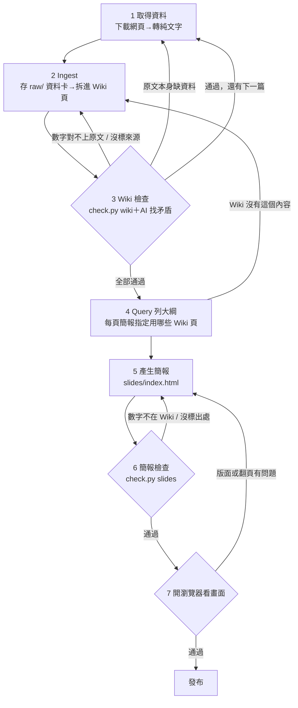

# 永續時尚與快時尚 LLM Wiki ＋ 教學簡報

第十週作業：先建一個 LLM Wiki，再只用 Wiki 的內容做教學 HTML 簡報。

- **GitHub repo（Wiki 全部檔案）**：https://github.com/wllllllllam/hw10-llm-wiki
- **教學簡報**：https://wllllllllam.github.io/hw10-llm-wiki/slides/ （← → 鍵或左右滑動翻頁，左下角標這頁出自哪個 Wiki 頁）
- **Wiki 目錄**：[wiki/index.md](wiki/index.md)（頁面裡的 `[[頁名]]` 是 Wiki 內部連結寫法，對應 `wiki/頁名.md`）
- **給 AI 的規則**：[CLAUDE.md](CLAUDE.md)
- **檢查腳本**：[workflow/check.py](workflow/check.py)；每次的檢查輸出：[workflow/runs/](workflow/runs/)

## 1. Wiki 主題與簡介

主題是「永續時尚與快時尚」：快時尚是什麼、它造成哪些環境和勞工代價、有哪些出路。讀者設定為完全不懂時尚產業的人。

照 Karpathy 的 LLM Wiki 做法分三層：

| 層 | 放什麼 | 誰改 |
|---|---|---|
| `raw/` | 6 篇原始資料卡（網址、日期、英文原句摘錄） | 只增不改 |
| `wiki/` | AI 整理的 8 個中文主題頁＋目錄、來源清單、處理紀錄 | AI |
| `CLAUDE.md` | Wiki 的格式和三個動作（Ingest／Query／Lint）的規則 | 我和 AI 討論後定 |

收了 6 篇資料：

| 編號 | 來源 |
|---|---|
| S1 | 歐洲議會〈The impact of textile production and waste on the environment〉 |
| S2 | UN News〈UN launches drive to highlight environmental cost of staying fashionable〉2019 |
| S3 | Ellen MacArthur 基金會〈A new textiles economy〉2017＋時尚總覽頁 |
| S4 | Clean Clothes Campaign〈Rana Plaza〉 |
| S5 | Wikipedia〈Fast fashion〉 |
| S6 | Wikipedia〈Sustainable fashion〉 |

「先討論、後生成」：動手前 AI 先提了三個服設方向，每個都附預計的 Wiki 頁面大綱，我選了這個主題才開始生成。
討論內容記在 [wiki/log.md](wiki/log.md) 第一段。

## 2. Loop / Graph 設計

文字版：取得資料 → Ingest 進 Wiki → **Wiki 檢查** → 查 Wiki 列大綱 → 產生簡報 → **簡報檢查** → 看畫面 → 發布

**哪些步驟會重複執行？**
- 「取得資料 → Ingest → Wiki 檢查」是一個迴圈，每篇資料跑一次（6 篇就跑 6 圈）。
- 「產生簡報 → 簡報檢查 → 看畫面」是第二個迴圈，檢查沒過就回去改簡報，直到通過。

**哪些地方需要檢查或重新生成？**

| 檢查點 | 怎麼檢查 | 沒過回到哪 |
|---|---|---|
| 3 Wiki 檢查 | 腳本：每條重點都有 [S1]～[S6]；每個數字都在原文找得到；[[連結]] 連得到；每篇資料都被引用。AI：通讀找來源矛盾 | 2 重寫那一條；原文就沒有 → 1 再找資料 |
| 4 列大綱 | 每頁簡報先指定 Wiki 頁 | Wiki 沒有 → 2 先補 Wiki，不准直接寫進簡報 |
| 6 簡報檢查 | 腳本：每頁都標了出處頁；每個數字都在那個 Wiki 頁裡 | 5 重新產生那一頁 |
| 7 看畫面 | 在 Chrome 打開截圖、實際翻頁 | 5 |

**為什麼這樣設計？**
- AI 最常出錯的是「憑記憶補數字」。簡報上的數字最容易被當真，所以每個數字都要能一路追回原文：簡報 → Wiki 頁 → raw 原文。
- 檢查交給規則寫死的 Python 腳本，不叫 AI 檢查自己：同一個 AI 很難發現自己編的東西，而且腳本每次結果都一樣、不用錢。
- 腳本只能比對數字，判斷不了「兩個來源說法不一樣」，所以這部分留給 AI 通讀，寫進 [contradictions.md](wiki/contradictions.md)。

## 3. 實際執行紀錄（2026-11-23）

所有輸出都在 [workflow/runs/](workflow/runs/)，檔名是執行時間。

| 時間 | 檢查 | 結果 | 錯在哪 | 怎麼修 |
|---|---|---|---|---|
| 22:14:57 | wiki | ❌ 20 個錯誤 | 10 個是「相關頁面」這種只放連結的行被要求標來源（規則太嚴）；10 個是數字對不上原文：英文寫法變阿拉伯數字（eight-story → 8 層、March → 3 月）、換算單位（93 billion → 930 億），以及 **1 個原文沒有的換算**（2,000 gallons → 7,570 公升，是 AI 自己算的） | 腳本學會認英文數字、月份、億／萬換算；只放連結的行不檢查；**刪掉 7,570 那句** |
| 22:15:20 | wiki | ✅ 通過 | | |
| 22:16:13 | slides | ❌ 8 個錯誤＋1 個提醒 | 8 個全是章節編號（「1 快時尚是什麼」「3 人的代價」）被當成事實數字；提醒：「來源矛盾」頁沒被任何一頁引用 | 章節編號放進 kicker／step 標籤讓腳本略過；第 5、6 頁的數字其實依據矛盾頁的判斷，補標出處，並在碳排那句加上「另一份研究估 2-8%」 |
| 22:16:30 | slides | ✅ 通過 | | |
| 22:16:49 | slides（故意放錯測試） | ❌ 1 個錯誤 | 在第 4 頁塞一句 Wiki 沒有的「全球每年生產 1,000 億件衣服」，腳本抓到 `P2 第 4 頁 數字 1000 不在 fast-fashion.md 裡` | 還原。證明檢查擋得住編出來的數字 |
| 畫面 | Chrome | ❌→✅ | 直接改網址的頁碼（#4）不會換頁 | 加上監聽網址頁碼的程式，重測翻頁正常 |

Wiki 檢查之外，AI 通讀時找到 5 處來源矛盾，例如水污染（S1 說「20% 的乾淨水源污染」，S2 說「20% 的廢水」，意思不一樣）、
Rana Plaza 死亡人數（S4 寫 1,134 人，S5 只寫超過 1,000 人）。簡報採用的版本和理由都寫在 [contradictions.md](wiki/contradictions.md)。

## 4. 反思

**哪一個節點最常出錯？**
「2 Ingest（把原文整理成 Wiki）」。第一次 Wiki 檢查的 20 個錯誤裡，真正內容有問題的都出在這一步：
AI 翻成中文時會順手改寫數字（換單位、把英文數字寫成阿拉伯數字），大多沒錯，但混進了一個原文根本沒有的換算（7,570 公升）。
這種錯最危險，因為看起來很合理。
第二多的是檢查節點本身：規則一開始寫得太死，把「相關頁面連結」和「章節編號」都當成錯誤（18 個誤報）。

**發現問題後，把檢查往前移到哪一步？**
- Wiki 檢查原本是 6 篇全部收完才跑，錯誤一次冒出 20 個，分不出是哪一篇造成的。現在改成**每收完一篇就跑一次**（迴圈裡的第 3 步）。
- 簡報原本是寫完整份才檢查出處。現在改成在**第 4 步列大綱時**就要指定每頁用哪個 Wiki 頁，Wiki 沒有的內容在這一步就退回 Ingest，不會等到寫完才發現。

**有沒有因此修改 workflow / graph？為什麼？**
有，改了三處，都寫進 [CLAUDE.md](CLAUDE.md)：
1. 檢查時機往前移（如上），graph 從「全部收完 → 檢查一次」改成「每一篇一個迴圈」。
2. 加一條 Ingest 規則：換算單位要把原文寫法放括號，原文沒有的換算不准寫。從源頭擋住 AI 自己算的數字，不是等檢查抓到。
3. 調整檢查腳本：認得英文數字、月份、億／萬換算，略過只有連結的行和章節編號。不調的話誤報太多，真正的錯誤會被淹沒，久了就沒人想看檢查結果。

腳本還做不到的事：它只比對數字，文字說法（例如「最嚴重的工安事故」）有沒有被改意思，還是要靠 AI 通讀和人看。
